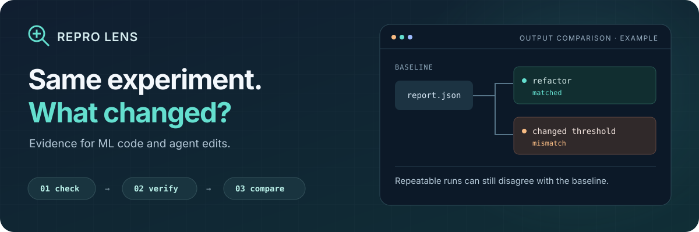

<div align="center">
  

  <h1>Repro Lens</h1>

  **Static reproducibility checks and comparisons of recorded experiment outputs.**

  [](https://github.com/00200200/repro-lens/actions/workflows/ci.yml)
  [](https://github.com/00200200/repro-lens/releases/latest)
  [](pyproject.toml)
  [](LICENSE)
  [](https://github.com/00200200/repro-lens/stargazers)

  <br>

  [**Explore Demo**](https://00200200.github.io/repro-lens/) · [**Examples**](examples/README.md) · [**Contribute**](CONTRIBUTING.md)
</div>

<br>

Catch reproducibility risks before a commit, replay an experiment, and compare outputs before and after a change. Built for ML developers and AI coding agents.

## 🚀 See it in action

Open the [browser demo](https://00200200.github.io/repro-lens/) or try the commands below to check for known reproducibility risks and compare declared outputs.

## ✨ Why Repro Lens?
Repro Lens screens Python code for known reproducibility risks without executing it. Runtime verification compares declared outputs from repeated runs; comparing reports from before and after an edit checks those outputs across revisions. A clean scan or matching runs do not prove general reproducibility or scientific validity.

* **Static checks without ML dependencies:** The scanner uses the Python standard library and needs no API keys. Runtime verification requires the experiment's own environment and takes as long as its runs.
* **Selected framework rules:** Checks for documented API patterns in `scikit-learn`, `XGBoost`, `LightGBM`, `PyTorch`, `TensorFlow`, and `Lightning`; coverage is not exhaustive.
* **Agent workflow:** A bundled skill guides an assistant through findings, proposed changes, and before/after evidence. Scientific choices still need review.

## 🛠️ Core Commands

| Command | Question it answers | Evidence |
| --- | --- | --- |
| **`repro-lens check`** | Is there a known reproducibility risk in this code? | Static findings with file locations |
| **`repro-lens verify`** | Do two runs produce matching declared outputs? | Metrics, artifact hashes, logs |
| **`repro-lens compare`** | Did the edit preserve the baseline outputs? | Output differences (ideal for refactors) |
| **`repro-lens agent-review`** | What should an agent do with the before/after evidence? | Machine-readable verdict and risk assessment |
| **`repro-lens lsp`** | Can I see reproducibility findings while editing? | Standard LSP diagnostics for Python documents |

`verify` normally runs the configured experiment twice. Declared numeric metrics are compared with configured tolerances; declared artifacts use SHA-256 hashes. Undeclared outputs are not checked. To assess a refactor, retain a baseline report and compare it with a report from the changed revision. See the [verification contract](docs/verification.md).

## 📦 Quickstart

Install using `uv` (or `pip`):
```bash
uv tool install 'git+https://github.com/00200200/repro-lens.git@v0.3.1'
```

Scan your project without running its code:
```bash
repro-lens check --root /path/to/project
```
*Example output:*
```python
train_test_split(X, y)  # ❌ R101: no explicit random_state
```

Preview proposed edits before applying them in-place:
```bash
repro-lens check --diff      # preview proposed edits to Python files
repro-lens check --fix       # apply proposed edits in-place
```

Review every edit: the default seed is `42` (override it with `--seed`), seed changes can alter experiment results, and some findings receive ignore comments rather than a behavioral fix. Notebook cells are not autofixed. Suppressing a finding does not establish reproducibility.

Try a two-run check of the template's declared outputs:
```bash
repro-lens init repro-demo --name repro_demo  # or --template pytorch
cd repro-demo
uv sync --locked
repro-lens verify
```

Unlike `check`, `verify` executes the configured command. The default host execution inherits the environment and does not isolate credentials or network access; review the command and its resource needs first.

## 🤖 AI Coding Agents & pre-commit

**Pre-commit hook:** Run static screening before commits. Findings at the configured failure level can block a commit; advisory `review` findings do not. Passing the hook does not guarantee reproducibility.
```yaml
repos:
  - repo: https://github.com/00200200/repro-lens
    rev: v0.3.1
    hooks:
      - id: repro-lens
```

**Coding Agents:** Use the [Reproducibility Skill](skills/reproducibility/SKILL.md) to inspect findings, propose changes, and compare recorded evidence.
> *"Use the reproducibility skill to refactor this training script while preserving its declared outputs."*

## 📚 Learn More
- [Framework Coverage](docs/frameworks.md)
- [Verification Contract](docs/verification.md)
- [Community Support](docs/support.md)
- [Architecture & Rules](docs/architecture.md)

---
<div align="center">
If you find Repro Lens useful, please consider <b>starring</b> the repository! ⭐
</div>
